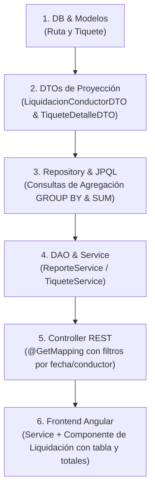

# Plan de Implementación: Módulo de Liquidación de Comisiones y Reportes de Tiquetes

Este documento contiene la planificación completa para arrancar con el nuevo módulo de **Liquidación de Comisiones de Conductores** y los reportes de viajes/rutas en **Transpem**.

---

## 1. Decisiones de Diseño y Arquitectura Acordadas

### A. Patrón Snapshot de Tarifas (Instantánea Histórica)
Para evitar crear rutas con años en el nombre (como `frontier-Gecelca 2026`) y garantizar que el cambio futuro de precios nunca altere la contabilidad del pasado:
* **En `Ruta`:** Se guardan las **tarifas vigentes/sugeridas**:
  * `tarifa_tonelada` (o `valor_tonelada`): Precio actual por tonelada.
  * `tarifa_comision`: Comisión actual pactada para el conductor en esta ruta.
* **En `Tiquete`:** Se guardan los **valores reales aplicados en cada viaje**:
  * `valor_tonelada`: Precio liquidado en la fecha del tiquete.
  * `valor_comision`: Comisión ganada por el conductor en ese viaje específico.

---

## 2. Paso a Paso para la Implementación



---

### Paso 1: Base de Datos y Entidades Java

1. **Alterar tablas en MySQL:**
   ```sql
   -- En Ruta:
   ALTER TABLE ruta ADD COLUMN tarifa_comision DOUBLE DEFAULT 0;
   
   -- En Tiquete:
   ALTER TABLE tiquete ADD COLUMN valor_tonelada DOUBLE DEFAULT 0;
   ALTER TABLE tiquete ADD COLUMN valor_comision DOUBLE DEFAULT 0;
   ```
2. **Actualizar entidades en Java:**
   * `Ruta.java`: agregar `tarifaComision`.
   * `Tiquete.java`: agregar `valorTonelada` y `valorComision`.

---

### Paso 2: DTOs para las Respuestas

1. **`LiquidacionConductorDTO.java`**:
   * `idConductor`, `cedula`, `nombreConductor`
   * `totalViajes` (`COUNT(t.id)`)
   * `totalToneladas` (`SUM(t.pesoToneladas)`)
   * `totalFlete` (`SUM(t.valorViaje)`)
   * `totalComision` (`SUM(t.valorComision)`)
2. **`TiqueteDetalleDTO.java`**:
   * Datos planos para tablas de consulta detallada (Conductor, Placa, Ruta, Valores).

---

### Paso 3: Repositorio (Consultas de Agregación en `TiqueteRepository`)

* Consulta para liquidar conductores en un rango de fechas:
  ```java
  @Query("""
      SELECT new transpem.DTO.LiquidacionConductorDTO(
          c.id,
          c.cedula,
          CONCAT(c.nombre, ' ', c.apellido),
          COUNT(t.id),
          COALESCE(SUM(t.pesoToneladas), 0L),
          COALESCE(SUM(t.valorViaje), 0L),
          COALESCE(SUM(t.valorComision), 0.0)
      )
      FROM Tiquete t
      JOIN t.conductor c
      WHERE t.fecha BETWEEN :fechaInicio AND :fechaFin
        AND (:idConductor IS NULL OR c.id = :idConductor)
      GROUP BY c.id, c.cedula, c.nombre, c.apellido
      ORDER BY c.nombre ASC
  """)
  List<LiquidacionConductorDTO> liquidarConductores(
      @Param("fechaInicio") Date fechaInicio,
      @Param("fechaFin") Date fechaFin,
      @Param("idConductor") Long idConductor
  );
  ```

---

### Paso 4: Capa DAO, Service y Controller

* **DAO:** Pasar la llamada desde `ITiqueteDAO` / `TiqueteDAOImpl`.
* **Service:** En `ReporteService` exponer `liquidarConductores(fechaInicio, fechaFin, idConductor)`.
* **Controller:** Endpoint en `ReporteController`:
  * `GET /api/v1/reportes/liquidacion?fechaInicio=...&fechaFin=...&idConductor=...`

---

### Paso 5: Frontend Angular

1. **Servicio (`reporte.service.ts`):** Método `obtenerLiquidacion(...)` con `HttpParams`.
2. **Nuevo Componente:** `LiquidacionConductoresComponent`
   * Filtros: Selector de Conductor (opcional), Fecha Desde, Fecha Hasta, Botón "Liquidar".
   * Tabla con resumen:
     * Nombre Conductor | Cédula | N° Viajes | Toneladas | Total Flete | **Total Comisión a Pagar**.
   * Tarjetas resumen o pie de tabla con gran total a pagar en el periodo.

