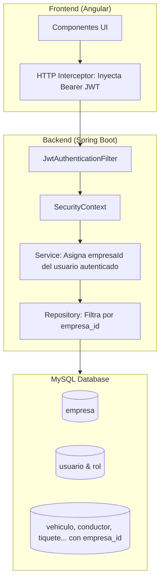

# Plan Arquitectónico: Seguridad y Multi-Empresa (Multi-Tenancy)

Este documento contiene el diseño y la guía de implementación paso a paso para incorporar seguridad con **Spring Security + JWT** y soporte **Multi-empresa** en el sistema de transporte.

---

## 1. Concepto Arquitectónico: Multi-Tenancy

Se utiliza el patrón de **Base de Datos Compartida con Discriminador de Columna (`empresa_id`)**.
- Una sola base de datos MySQL para toda la plataforma.
- Cada tabla de negocio (`vehiculo`, `conductor`, `tiquete`, `mina`, `ruta`, etc.) contiene una columna `empresa_id`.
- Los usuarios solo pueden visualizar, crear y modificar datos de la empresa a la que pertenecen.



---

## 2. Modelo de Datos Relacional

### Tabla `empresa`
```sql
CREATE TABLE empresa (
    id BIGINT AUTO_INCREMENT PRIMARY KEY,
    nit VARCHAR(20) NOT NULL UNIQUE,
    razon_social VARCHAR(150) NOT NULL,
    telefono VARCHAR(30),
    email VARCHAR(100),
    estado VARCHAR(20) DEFAULT 'ACTIVO',
    fecha_creacion TIMESTAMP DEFAULT CURRENT_TIMESTAMP
);
```

### Tabla `rol`
```sql
CREATE TABLE rol (
    id BIGINT AUTO_INCREMENT PRIMARY KEY,
    nombre VARCHAR(50) NOT NULL UNIQUE -- Ej: ROLE_SUPERADMIN, ROLE_ADMIN_EMPRESA, ROLE_OPERADOR
);
```

### Tabla `usuario`
```sql
CREATE TABLE usuario (
    id BIGINT AUTO_INCREMENT PRIMARY KEY,
    username VARCHAR(80) NOT NULL UNIQUE,
    password VARCHAR(255) NOT NULL, -- Hash BCrypt
    nombre_completo VARCHAR(150) NOT NULL,
    activo BOOLEAN DEFAULT TRUE,
    empresa_id BIGINT NULL, -- NULL si es SUPERADMIN global
    rol_id BIGINT NOT NULL,
    CONSTRAINT fk_usuario_empresa FOREIGN KEY (empresa_id) REFERENCES empresa(id),
    CONSTRAINT fk_usuario_rol FOREIGN KEY (rol_id) REFERENCES rol(id)
);
```

### Tablas de Negocio
A cada tabla existente se le adiciona la clave foránea:
```sql
ALTER TABLE vehiculo ADD COLUMN empresa_id BIGINT NOT NULL;
ALTER TABLE vehiculo ADD CONSTRAINT fk_vehiculo_empresa FOREIGN KEY (empresa_id) REFERENCES empresa(id);

ALTER TABLE conductor ADD COLUMN empresa_id BIGINT NOT NULL;
ALTER TABLE conductor ADD CONSTRAINT fk_conductor_empresa FOREIGN KEY (empresa_id) REFERENCES empresa(id);

ALTER TABLE tiquete ADD COLUMN empresa_id BIGINT NOT NULL;
ALTER TABLE tiquete ADD CONSTRAINT fk_tiquete_empresa FOREIGN KEY (empresa_id) REFERENCES empresa(id);
```

---

## 3. Jerarquía de Roles

| Rol | Alcance | Permisos |
| :--- | :--- | :--- |
| **`ROLE_SUPERADMIN`** | Global (`empresa_id = NULL`) | Crear/gestionar empresas, ver métricas globales. |
| **`ROLE_ADMIN_EMPRESA`** | Su propia empresa | Crear usuarios de su empresa, configurar maestros (vehículos, conductores, tarifas). |
| **`ROLE_OPERADOR`** | Su propia empresa | Registro diario de tiquetes y despacho. |
| **`ROLE_CONSULTOR`** | Su propia empresa | Solo lectura y exportación de reportes. |

---

## 4. Backend (Spring Boot 3)

1. **Dependencias:**
   - `org.springframework.boot:spring-boot-starter-security`
   - `io.jsonwebtoken:jjwt-api`, `jjwt-impl`, `jjwt-jackson` (versión 0.12.x)

2. **Flujo de Autenticación:**
   - `POST /api/v1/auth/login` valida credenciales contra la base de datos (con `PasswordEncoder` BCrypt).
   - Genera token JWT conteniendo `username`, `roles` y `empresaId`.

3. **Filtro de Peticiones (`JwtAuthenticationFilter`):**
   - Intercepta cada solicitud HTTP.
   - Extrae el token del header `Authorization: Bearer ...`.
   - Establece la autenticación en `SecurityContextHolder`.

4. **Aislamiento de Datos:**
   - En escrituras (`POST` / `PUT`), el backend asigna el `empresaId` del token automáticamente:
     ```java
     Long empresaId = SecurityUtils.getEmpresaIdAutenticada();
     entidad.setEmpresaId(empresaId);
     ```
   - En consultas (`GET`), se filtra por `empresaId` mediante consultas derivadas o con la anotación `@TenantId` de Hibernate 6.

---

## 5. Frontend (Angular)

1. **`AuthService`**: Almacena el token y provee métodos reactivos como `isAuthenticated()` y `hasRole(...)`.
2. **`AuthInterceptor`**: Clona cada solicitud HTTP agregando `Authorization: Bearer ${token}`.
3. **Guards de Rutas**:
   - `authGuard`: Protege rutas privadas, redirigiendo a `/login` si no hay sesión.
   - `roleGuard`: Bloquea módulos que no corresponden al rol del usuario.
4. **Vistas Dinámicas**: Uso de directivas condicionales para mostrar/ocultar botones y opciones según el rol.

